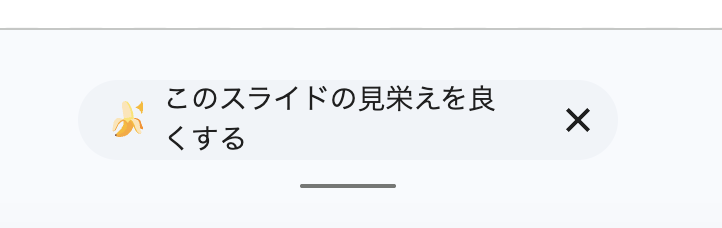

# Hide Slides Improvement Nudge

Google スライドを開くと編集画面の下部に必ず出てくる「このスライドの見栄えを良くする」（Gemini による提案）のボタンを非表示にする Chrome 拡張機能です。



## 特徴

- CSS を 1 つ差し込むだけで、JavaScript は使っていません
- 必要な権限はありません。`docs.google.com/presentation/` のページにだけ適用されます
- 外部への通信やデータの収集はしません

## インストール

Chrome ウェブストアには公開していないため、ソースから読み込みます。

1. このリポジトリをクローンするか、ZIP でダウンロードして展開する
   ```sh
   git clone https://github.com/otokichi3/hide-slides-improvement-nudge.git
   ```
2. Chrome で `chrome://extensions` を開く
3. 右上の「デベロッパー モード」をオンにする
4. 「パッケージ化されていない拡張機能を読み込む」を押し、クローンしたフォルダを選ぶ
5. 開いている Google スライドのタブを再読み込みする

## 仕組み

ボタンは次の要素の中に描画されています。

```html
<div class="appsSketchyGenerativeaiNudgesCanvasNudgeSurfaceSoyContainer"
     id="canvas-nudge-surface-soy-container">
  ...
  <div role="button" aria-label="このスライドの見栄えを良くする">...</div>
  ...
</div>
```

[`hide.css`](hide.css) でこのコンテナに `display: none !important` を指定し、ページの読み込み開始時（`document_start`）に差し込んでいます。

## 効かなくなったとき

Google が要素の ID やクラス名を変更すると、ボタンがまた表示されるようになります。その場合は DevTools でボタンを含む要素を調べ、`hide.css` のセレクタを更新してください。

## ファイル構成

| ファイル | 内容 |
| --- | --- |
| `manifest.json` | 拡張機能の設定（Manifest V3） |
| `hide.css` | ボタンを非表示にする CSS |
| `icons/` | 拡張機能のアイコン（`icon.svg` が元データ、PNG は `rsvg-convert` で書き出し） |
| `docs/nudge.png` | README 用のスクリーンショット |

## ライセンス

[MIT](LICENSE)
